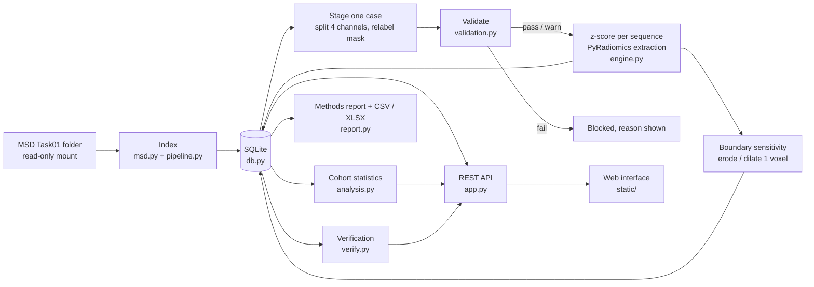
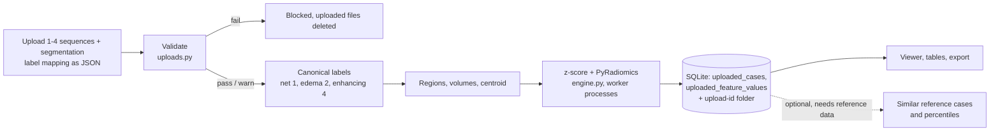

# NeuroVoxel

**A transparent, reproducible radiomics workspace for brain-tumour MRI: from raw multimodal volumes to validated, explorable, exportable image-derived features.**

Version 3.1.0 · Python 3.11 · FastAPI · PyRadiomics · SQLite · Docker · MIT licence (code)

> **Research and teaching software. NeuroVoxel is not a medical device. It makes no diagnosis, no prognosis and no treatment recommendation, and it contains no machine-learning model.**

---

## Table of contents

1. [Abstract](#1-abstract)
2. [Motivation and design philosophy](#2-motivation-and-design-philosophy)
3. [What NeuroVoxel does (and deliberately does not do)](#3-what-neurovoxel-does-and-deliberately-does-not-do)
4. [Dataset](#4-dataset)
5. [System overview](#5-system-overview)
6. [Scientific methods](#6-scientific-methods)
7. [Quality control: validation and verification](#7-quality-control-validation-and-verification)
8. [Using the application](#8-using-the-application)
9. [Installation and quick start](#9-installation-and-quick-start)
   - [Step-by-step researcher setup](RESEARCHER_SETUP.md)
10. [Configuration](#10-configuration)
11. [Repository structure](#11-repository-structure)
12. [REST API](#12-rest-api)
13. [Testing](#13-testing)
14. [Limitations and honest scope](#14-limitations-and-honest-scope)
15. [Data licence, ethics and privacy](#15-data-licence-ethics-and-privacy)
16. [How to cite](#16-how-to-cite)
17. [Roadmap](#17-roadmap)
18. [Author and acknowledgements](#18-author-and-acknowledgements)
19. [Licence](#19-licence)

---

## 1. Abstract

Radiomics converts medical images into large numbers of quantitative descriptors (shape, intensity statistics and texture). In practice, many radiomics workflows are hard to inspect: preprocessing choices are buried in scripts, numbers cannot easily be traced back to the image, and results are rarely checked against an independent reference.

**NeuroVoxel** is a self-hosted web application that takes the *Medical Segmentation Decathlon (MSD) Task01 BrainTumour* collection (484 labelled glioma cases; four MRI sequences and an expert-reviewed three-label segmentation per case) and, for every case:

* extracts **PyRadiomics** features for **4 MRI sequences × 3 standard BraTS tumour regions** (shape, first-order and five texture families);
* runs a **strict consistency validation** of the input files before any number is computed;
* quantifies **boundary sensitivity** (how much each feature changes if the segmentation is eroded or dilated by one voxel);
* places a case **among the other calculated cases** (percentiles) and compares **groups of cases** with non-parametric statistics, effect sizes and false-discovery-rate control;
* **verifies its own numbers** in four independent ways (independent re-run, textbook formulas, PyRadiomics' official baseline, and shapes with known mathematical answers, plus the IBSI digital phantom);
* generates an automatic **methods and reproducibility report** and exports results as CSV, XLSX and Markdown.

NeuroVoxel has **two analysis pathways** that share the same normalisation, region definitions and PyRadiomics engine:

* the **reference-cohort pathway** (called *Pipeline B* in the project report) works on the MSD data set as described above;
* **Pipeline A** lets a researcher analyse **a case of their own**. The user uploads one to four registered MRI sequences (T1, T1c, T2, FLAIR) and one segmentation, each as `.nii` or `.nii.gz`, and states what every label number means (`net`, `edema` or `enhancing`). The files are validated, the case is calculated with the same settings, and the saved result can be reopened or deleted later. Uploads are kept in their own database tables, so they never change the reference cohort. If the MSD data set is mounted, Pipeline A can also rank the five most similar reference cases and place the upload among the calculated cases (descriptive only).

The guiding principle is that **every number on screen can be traced to a setting, a file and a check**.

## 2. Motivation and design philosophy

| Principle | How it is implemented |
|---|---|
| **One source of truth for science** | Every setting that can change a number lives in [`config.py`](config.py). The extraction engine, the validator and the methods report all read from it, so they cannot disagree. |
| **Never assume, always read** | Channel order and label numbers are *read from the dataset's `dataset.json` and matched by name*, not hard-coded. The mapping used is stored in the database and shown in the interface. |
| **Fail loudly, not silently** | Each case passes a validation report with three statuses (`pass`, `warn`, `fail`). A `fail` blocks the analysis. A `warn` is stored with the results and shown to the user. |
| **Independent verification** | Results can be re-computed outside the application's own code path and compared value by value. |
| **Honest wording** | Outputs are labelled "among *N* calculated cases", "consistent with BraTS format", "approximate hemisphere". Nothing is presented as clinical evidence. |
| **Reproducibility** | Software versions, settings, label mapping, channel order and a PyRadiomics commit hash are recorded with each result and appear in the generated methods report. |
| **Data protection by design** | The dataset is mounted **read-only** and is never copied into the project or into the repository. |

## 3. What NeuroVoxel does (and deliberately does not do)

**Does**

* Index the whole MSD Task01 dataset (volumes, dominant sub-region, approximate hemisphere, quick consistency checks) once, quickly.
* Filter and search cases by tumour size, dominant sub-region, hemisphere and enhancement.
* Calculate radiomics features for one case, or for all cases matching a filter (capped by a safety limit).
* Show features across sequences and across sub-regions, with interactive charts.
* Show a case's percentile among calculated cases; compare two patients, or two groups of patients.
* Visualise the real segmentation in 2D and 3D (region "cinema", spatial locator, Shape Lab).
* Validate inputs, quantify boundary sensitivity, and verify the numbers.
* Export CSV / XLSX / a Markdown methods report, and give a read-only database viewer.
* **Pipeline A:** analyse your own case. Upload one to four sequences plus a segmentation, map the label numbers to net / edema / enhancing, validate, calculate, and inspect the result in the same viewers and tables.
* Save, reopen and delete uploaded analyses. Uploads stay separate from the reference cohort.
* Optionally list the five most similar reference cases and show percentiles of an upload among the calculated reference cases (descriptive only).

**Does not**

* No diagnosis, grading, survival or treatment prediction, and no machine learning.
* No skull-stripping, co-registration or resampling (MSD/BraTS data are assumed to be pre-processed; the application only checks them for consistency). Uploaded files in Pipeline A must already share one 1 mm isotropic grid; this is checked but never repaired.
* No clinical metadata. The MSD dataset has none, so cohorts are defined from image-derived properties only.
* No claim that one sequence or region is "better" clinically (see [Section 6.6](#66-group-comparison-and-ranking)).

## 4. Dataset

| Item | Value |
|---|---|
| Name | Medical Segmentation Decathlon, **Task01_BrainTumour** |
| Content | 484 labelled training cases (plus unlabelled test cases that NeuroVoxel does not use) |
| Modalities (MSD channel order) | FLAIR, T1-weighted, T1-weighted with gadolinium contrast (T1gd), T2-weighted |
| Labels (MSD numbering) | 1 = oedema, 2 = non-enhancing tumour, 3 = enhancing tumour |
| Geometry | 240 × 240 × 155 voxels, 1 mm isotropic, skull-stripped (BraTS convention) |
| Origin | Derived from the BraTS challenge data |
| Licence | **CC-BY-SA 4.0** |
| Where to get it | <https://registry.opendata.aws/msd/> and <http://medicaldecathlon.com/> |

**The dataset is NOT included in this repository.** Download it yourself and mount it read-only (see [Installation](#9-installation-and-quick-start)). Citations and licence details are in [`CITATIONS.md`](CITATIONS.md) and [Section 16](#16-how-to-cite).

**Label convention used internally.** MSD labels are renamed once, on staging, to the BraTS 2017–2021 numbers:

| Region | Internal label(s) | Meaning |
|---|---|---|
| Necrotic / non-enhancing core | 1 | MSD label 2 |
| Peritumoral oedema | 2 | MSD label 1 |
| Enhancing tumour | 4 | MSD label 3 |

Three standard (deliberately overlapping) BraTS evaluation regions are analysed:

| Analysed region | Labels | Description |
|---|---|---|
| Whole tumour | 1 + 2 + 4 | everything that is tumour or oedema |
| Tumour core | 1 + 4 | necrotic/non-enhancing plus enhancing |
| Enhancing tumour | 4 | enhancing part only |

## 5. System overview



**Pipeline A (uploaded case)**



**Technology**

| Layer | Technology |
|---|---|
| Backend | Python 3.11, FastAPI, Uvicorn, python-multipart (file uploads) |
| Radiomics | PyRadiomics (built from the official GitHub repository), SimpleITK |
| Imaging I/O | nibabel, NumPy, SciPy |
| Data handling and export | pandas, openpyxl |
| Storage | SQLite (results, validation reports, jobs, provenance, saved uploads) |
| Frontend | Plain HTML/CSS/JavaScript, Chart.js (charts), three.js (3D views), NiiVue (volume viewer), all vendored so the app works offline |
| Deployment | Docker and Docker Compose (non-root container user) |

Heavy computation runs in separate worker processes (CPU only). One heavy job runs at a time, which keeps memory predictable on a laptop.

## 6. Scientific methods

All values below are defined in [`config.py`](config.py).

### 6.1 Case staging
For each case, the 4D MSD file is split into four single-channel 3D volumes using the channel order read from `dataset.json`. The segmentation is relabelled to internal labels (1, 2, 4). Staged files are written to a work folder and never to the dataset folder. They can always be re-created.

### 6.2 Intensity normalisation
Each sequence of each patient is **z-scored on its non-zero (brain) voxels only**; background stays exactly zero. PyRadiomics' own normalisation is switched off (`normalize = False`) because it would include the zero background of a skull-stripped volume in its mean and standard deviation.

### 6.3 Discretisation and PyRadiomics settings
Texture features use a **fixed bin width of 0.25** (z-score units), which gives roughly 15–40 grey levels for a typical tumour.

| Setting | Value |
|---|---|
| `binWidth` | 0.25 |
| `normalize` | False (handled by NeuroVoxel) |
| `resampledPixelSpacing` | None (data are already 1 mm isotropic) |
| `preCrop` | True |
| Image type | Original only |
| Feature classes | shape, first-order, GLCM, GLRLM, GLSZM, NGTDM, GLDM |

**4 sequences × 3 regions.** Intensity and texture features are computed for every sequence-region pair. **Shape features depend only on the mask**, so they are computed once per region and stored under a pseudo-sequence named `mask`.

A region with fewer than **64 voxels** (4 × 4 × 4) is not analysed, because texture features of a handful of voxels are not meaningful. This is a pragmatic project choice, not a published standard, and it can be changed with `NV_MIN_REGION_VOXELS`.

### 6.4 Validation before extraction
See [Section 7.1](#71-input-validation-per-case).

### 6.5 Boundary sensitivity
Segmentation boundaries are uncertain. For each region, binary masks are **eroded** and **dilated** by one voxel (ball structuring element, radius 1), features are recomputed, and the change is reported. Dilation is restricted to voxels that are non-zero in at least one of the four sequences (inside the brain). This shows which features are stable with respect to small boundary changes and which are not.

### 6.6 Group comparison and ranking
Implemented in [`analysis.py`](analysis.py). Everything is **descriptive and exploratory**, and each number is labelled with the number of cases it is based on.

| Method | Purpose |
|---|---|
| Percentiles | Where a case lies among the calculated cases, per feature (needs at least 5 calculated cases) |
| Mann-Whitney U test | Non-parametric comparison of two groups (each group needs at least 3 cases) |
| Cliff's delta | Effect size; interpreted with the conventional thresholds 0.147 / 0.33 / 0.474 (small / medium / large; Romano et al.) |
| Benjamini-Hochberg FDR | Multiple-testing correction across all features |
| Correlation with region volume | Shows how much a feature simply reflects tumour size |
| Set ranking | Which sequence × region (or feature class) separates two groups more, **by effect size** |

"Which is better" in NeuroVoxel therefore means *which sequence or region separates two defined groups more strongly in this dataset*. **It does not mean clinical value.**

### 6.7 Spatial position
The centroid, an approximate hemisphere, depth and a three-view locator are computed from the image affine. The midline is taken as the centre of the non-zero brain extent along the left-right axis. **No atlas registration is used, so hemisphere is approximate.**

### 6.8 Pipeline A: analysing an uploaded case
Implemented in [`uploads.py`](uploads.py); the routes are under `/api/upload`. Pipeline A uses the same normalisation, regions and PyRadiomics settings as the reference cohort (Sections 6.2 to 6.3).

**Input.** One to four sequences chosen from T1, T1c, T2 and FLAIR, plus one segmentation, each a single `.nii` or `.nii.gz` file of at most 1 GB. The user enters a JSON mapping from every non-zero label number to `net`, `edema` or `enhancing`, for example `{"1":"net","2":"edema","4":"enhancing"}`. The mapping is explicit because label numbers differ between data sets, and it is stored with the validation report.

**Validation.** Eleven checks run before anything is calculated. A `fail` blocks the analysis and the uploaded files are deleted; a `warn` allows it and is shown with the result.

| Check | Result if violated |
|---|---|
| Files are readable 3D NIfTI volumes (no NaN or infinite values) | fail |
| File names agree with the selected sequence roles | fail if clearly wrong, warn if not recognisable |
| Sequences and segmentation share one grid (size, spacing, origin, direction) | fail |
| Voxel spacing is 1 mm isotropic | fail (resample first) |
| Volume size follows the BraTS grid, 240 × 240 × 155 | warn |
| Every non-zero label is mapped, every mapped label exists, each sub-region is used once | fail |
| Segmentation is not empty | fail |
| Whole tumour has at least 64 voxels | fail |
| Selected sequences are distinct images | fail |
| Segmentation overlaps the non-zero image (pass at least 90 %, warn at least 60 %) | warn or fail |
| Sequences contain intensity variation | fail |
| Skull-stripped appearance, one per sequence (shown only if violated) | warn |

**Canonical labels and regions.** Labels are converted to the internal values net 1, edema 2, enhancing 4, and the same three overlapping regions as in Section 4 are built (whole tumour, tumour core, enhancing tumour). The new segmentation keeps the spacing, origin and direction of the uploaded mask, so the viewers stay aligned with the scan. Volumes come from voxel counts and voxel volume; the centroid is given in voxel and physical coordinates.

**Features.** Shape features are computed from each mask alone and stored under the pseudo-sequence `mask`. First-order and texture features are computed for each selected sequence and region on the z-scored image. A region below 64 voxels keeps its volume but is skipped for radiomics. Each sequence-region pair is one task, run in parallel worker processes.

**Saving.** Each upload gets a random identifier (`upload-` plus 16 hexadecimal characters). Its folder in the data volume keeps the uploaded volumes, the canonical segmentation, the region masks and `result.json`. The result is also written to the tables `uploaded_cases` and `uploaded_feature_values`, which are not linked to the reference tables. Deleting an upload removes both the folder and the rows. The automatic clean-up of staged reference cases never touches `upload-` folders.

**Safe handling of files.** Only `.nii` and `.nii.gz` are accepted. Names are reduced to the base name and replaced by fixed names inside the private folder, the identifier is checked against a strict pattern, and only the upload's own selected volumes can be downloaded.

**Similar reference cases (optional, needs the MSD data set).** A shortlist is made from the index: only cases that passed or warned in validation are considered, and the five with the lowest value of |ln(V_upload / V_reference)| + 0.15 × Σ|centroid difference| / 240 are kept, where V is the whole-tumour volume. Shortlisted cases that are not yet calculated are calculated on demand. The upload is then compared on the features both cases share (same sequence, region, feature family and name). For each shared feature the relative difference is min(|a − b| / max(|a|, |b|, 10⁻⁸), 10), and the displayed score is 100 / (1 + mean relative difference). The page shows the top five cases with the number of shared values, the score per sequence and the five closest features. **This percentage is a descriptive ranking score. It is not a probability, a diagnosis, a clinical risk or a validated similarity measure.**

**Percentiles of an upload.** For each uploaded feature the application gives its empirical percentile among the calculated reference cases (ties count as half), with the cohort size, median and quartiles. It is shown only if at least 5 reference cases are calculated, and it describes position within that subset, not a population norm.

## 7. Quality control: validation and verification

### 7.1 Input validation (per case)
[`validation.py`](validation.py) checks each staged case before any feature is computed. The report is intentionally worded *"consistent with the MSD Task01 (BraTS-derived) format"*: the checks show that files agree with each other and with the supported conventions. They cannot prove how the data were produced.

| Status | Meaning |
|---|---|
| `pass` | Fine |
| `warn` | Allowed, but shown to the user and stored with the results |
| `fail` | Blocks the analysis |

Examples of checks and thresholds (all in `config.py`): expected size (240 × 240 × 155) and spacing (1 mm); only allowed labels (0, 1, 2, 4); fraction of the mask lying inside the brain (pass at least 90 %, warn at least 60 %); Dice overlap between brain masks of the sequences (pass at least 90 %, fail below 50 %); a minimum fraction of exactly-zero background (skull-stripped data leave most of the box at zero); plausibility warnings (oedema should be FLAIR-bright, enhancing tumour brighter on T1c than T1); file-role detection from file names.

### 7.2 Verification (per case, four independent ways)
[`verify.py`](verify.py) and the stand-alone [`tools/verify_against_standard.py`](tools/verify_against_standard.py) re-check stored numbers:

1. **Independent re-run.** The raw 4D MSD file is read directly, split and z-scored by separate code, plain PyRadiomics is run with the recorded settings, and every stored value is compared.
2. **Textbook formulas.** First-order features are recomputed with NumPy only (population variance; non-excess kurtosis as PyRadiomics defines it).
3. **Official PyRadiomics baseline.** PyRadiomics is run on its own published brain MRI test cases (`brain1`, `brain2`), and results are compared with the project's official baseline values, using the PyRadiomics project's own acceptance limit of 3 %.
4. **Known shapes.** A sphere and an ellipsoid whose volume, surface area and axis lengths are known mathematically are measured, with stated tolerances.

The stand-alone script additionally compares against the **IBSI-1 digital phantom** (Image Biomarker Standardisation Initiative) reference values. The three IBSI axis-length values match only after PyRadiomics' N-1 covariance convention is accounted for, and the script states this explicitly.

### 7.3 Reproducibility
Every result stores software versions (Python, NumPy, SimpleITK, PyRadiomics, NeuroVoxel), the PyRadiomics commit, all extraction settings, the label mapping and channel order. A **methods and reproducibility report** (Markdown) can be generated for any case. Project-level reproducibility information is available at `/api/reproducibility` (JSON and CSV also provided).

## 8. Using the application

| Page | Purpose |
|---|---|
| **Dataset** (step 1) | Index the dataset once; see summary charts of the whole collection |
| **Explorer** (step 2) | Filter cases; calculate one case or all matching cases |
| **Upload a case** (Pipeline A) | Upload your own sequences and segmentation, map the labels, validate and calculate; reopen or delete saved uploads; optional *Find similar cases* |
| **Case** | Seven tabs: *Across sequences*, *Across sub-regions*, *Among calculated cases*, *Boundary sensitivity*, *Validation*, *Verification*, *Export*; plus region cinema, spatial locator and Shape Lab |
| **Compare** | Patient against patient |
| **Larger comparisons** | Group against group |
| **Data & clean-up** | See disk usage and delete results |
| **Database viewer** (`/db`) | Read-only view of everything stored; nothing can be changed there |

Typical workflow (reference cohort): index → filter → calculate a case → inspect validation and verification → examine sequences and regions → compare with other calculated cases → export.

Typical workflow (your own case): open **Upload a case** → choose the files and enter the label mapping → **VALIDATE AND CALCULATE** → read every warning → inspect the result → optionally find similar reference cases → delete the upload when it is no longer needed.

## 9. Installation and quick start

### Requirements
* Windows, macOS or Linux with **Docker Desktop** (or Docker Engine and Compose)
* About 5 GB free disk space for the Docker image and results (the dataset itself is separate, about 7 GB)
* The MSD Task01_BrainTumour folder (the one that contains `dataset.json`)

### Steps (Windows)
1. Clone this repository: `git clone https://github.com/hariniisathappan/NeuroVoxel.git`
2. **Do not put the dataset inside the project folder.**
3. Open `docker-compose.yml` and set the dataset line to *your* folder, keeping the `:/data/msd:ro` suffix:
   ```yaml
   - "E:/Dataset_tumor/Task01_BrainTumour:/data/msd:ro"
   ```
4. Start Docker Desktop, then double-click `Start-NeuroVoxel.bat`. The first build takes several minutes.
5. The browser opens at <http://127.0.0.1:8000>.
6. Go to **Dataset → INDEX DATASET** (once; a few minutes for 484 cases).
7. Go to **Explorer**, filter, then **CALCULATE** (about 20-60 s per case) or *Calculate matching*.

### Steps (macOS / Linux)
```bash
git clone https://github.com/hariniisathappan/NeuroVoxel.git
cd NeuroVoxel
# edit docker-compose.yml: set the dataset path, e.g. "/path/to/Task01_BrainTumour:/data/msd:ro"
docker compose up -d --build
# open http://127.0.0.1:8000
```

Stop with `docker compose down`. Results are kept in the Docker volume `neurovoxel_data`. This includes the reference database and saved Pipeline A upload results. Uploads remain separate from the indexed reference cohort. The server listens on `127.0.0.1` only (not on the network).

### Using Pipeline A without the data set
The reference data set is optional. To analyse only your own case, put `#` at the start of the dataset line in `docker-compose.yml`. Pipeline A then works as usual; indexing, cohort functions and similar-case search are unavailable, and the home page may show "Dataset folder not found". A longer guide is in [`RESEARCHER_SETUP.md`](RESEARCHER_SETUP.md).

`docker compose down` keeps your saved results and uploads. **`docker compose down -v` deletes them.**

### Where the database and dataset live

The live SQLite database is `neurovoxel_v3.sqlite3` inside Docker at `/var/lib/neurovoxel/`. It is kept in the persistent Docker volume `neurovoxel_data`; it is not the `nv.sqlite3` file in the project folder. The `/db` page reads the live database and is read-only. Pipeline A results are stored in `uploaded_cases` and `uploaded_feature_values`; they are not added to the reference-cohort `cases` table.

To open a local copy in DB Browser for SQLite, start Docker Desktop and NeuroVoxel, then run this from PowerShell in the project folder:

```powershell
.\tools\Export-NeuroVoxelDatabase.ps1
```

Open `database\neurovoxel_v3.sqlite3`. It is a point-in-time snapshot; rerun the script after new indexing, calculations, or uploads to refresh it. The database folder contains no MRI scans.

Download/extract the MSD `Task01_BrainTumour` dataset separately from the application project. Keep the dataset folder wherever you have enough disk space, with `dataset.json`, `imagesTr`, and `labelsTr` directly inside it. Set that folder's Windows path on the dataset mount line in `docker-compose.yml`; the app mounts it read-only. The dataset is not kept in RAM and is not copied into the SQLite database.

## 10. Configuration

Scientific settings are in [`config.py`](config.py). Runtime options are environment variables, set in `docker-compose.yml`:

| Variable | Default | Meaning |
|---|---|---|
| `NV_DATASET_DIR` | `/data/msd` | Where the dataset is mounted inside the container |
| `NEUROVOXEL_DATA_DIR` | `/var/lib/neurovoxel` (Docker) | Database and staged files |
| `NV_WORKERS` | min(4, CPUs) | Worker processes for extraction |
| `NV_INDEX_THREADS` | min(4, CPUs) | Threads used while indexing |
| `NV_MAX_BATCH` | 60 | Safety cap for "calculate all matching" |
| `NV_MIN_REGION_VOXELS` | 64 | Smallest region that is analysed |

## 11. Repository structure

```
NeuroVoxel/
├── app.py                  FastAPI server and REST routes
├── config.py               single source of truth for scientific + runtime settings
├── msd.py                  read-only MSD reader; label/channel mapping from dataset.json; index + staging
├── pipeline.py             indexing, per-case and batch calculation, clean-up
├── validation.py           strict per-case consistency report (pass / warn / fail)
├── engine.py               PyRadiomics extraction (4 sequences x 3 regions) + boundary sensitivity
├── analysis.py             percentiles, group comparison (Mann-Whitney, Cliff's delta, FDR), rankings
├── verify.py               four-way verification of stored numbers (web routes)
├── report.py               automatic methods / reproducibility report (Markdown)
├── advanced.py             geometry endpoints for 3D views (locator, sub-regions, surface)
├── dbview.py               read-only database viewer + reproducibility endpoints
├── uploads.py              Pipeline A: upload, validation, label mapping, extraction, saved uploads, similar cases, percentiles
├── db.py, jobs.py          SQLite storage; background job runner
├── static/                 web interface (HTML, JS, CSS, vendored libraries; works offline)
├── reference/
│   ├── ibsi_phantom/       IBSI-1 digital phantom (CC-BY 4.0)
│   └── pyradiomics_brain/  PyRadiomics test cases + official baseline values (BSD-3)
├── tools/
│   ├── verify_against_standard.py   stand-alone verification (IBSI phantom + independent re-run)
│   ├── make_synthetic_msd.py        tiny SYNTHETIC dataset for testing only
│   └── Export-NeuroVoxelDatabase.ps1  copy of the live database for DB Browser for SQLite
├── database/               notes for the local database snapshot (the .sqlite3 file itself is not published)
├── tests/                  end-to-end tests (synthetic data)
├── Dockerfile, docker-compose.yml, Start-NeuroVoxel.bat, requirements.txt
├── RESEARCHER_SETUP.md     step-by-step guide for other researchers (with and without the data set)
├── LICENSE                 MIT (code)
├── CITATIONS.md            data licence + all citations
└── CITATION.cff            machine-readable citation ("Cite this repository")
```

## 12. REST API

The application is a normal FastAPI service. Interactive documentation is available at <http://127.0.0.1:8000/docs> while it runs. Main routes:

| Route | Purpose |
|---|---|
| `GET /api/status`, `GET /api/dataset/summary`, `GET /api/dataset/charts` | Application and dataset overview |
| `POST /api/dataset/index` | Index the dataset |
| `GET /api/cases`, `GET /api/cases/{id}` | List/filter cases; case details |
| `POST /api/cases/{id}/calculate`, `POST /api/cases/calculate-batch` | Run extraction |
| `POST /api/cases/{id}/sensitivity/start` | Run boundary sensitivity |
| `GET /api/cases/{id}/results`, `/sensitivity`, `/distribution` | Stored results |
| `POST /api/cohort/percentiles`, `/api/cohort/compare`, `GET /api/cohort/feature(s)` | Cohort statistics |
| `POST /api/compare/cases` | Patient-against-patient comparison |
| `GET /api/cases/{id}/export.csv`, `/export.xlsx`, `/report.md` | Exports |
| `GET /api/cases/{id}/download/segmentation` | Staged segmentation |
| `GET /api/storage`, `POST /api/storage/cleanup`, `DELETE /api/results` | Housekeeping |
| `GET /api/reproducibility` (`.json`, `.csv`) | Software versions and settings |
| `POST /api/upload/analyze` | Pipeline A: upload files and label mapping, validate and calculate |
| `GET /api/upload/recent`, `GET` / `DELETE /api/upload/{upload_id}` | List, reopen or delete saved uploads |
| `GET /api/upload/{upload_id}/volume/{name}` | The upload's own volumes for the viewers |
| `POST /api/upload/{upload_id}/similar` | Five most similar reference cases (descriptive) |
| `GET /api/upload/{upload_id}/percentiles` | Percentile of uploaded values among calculated reference cases |
| `GET /api/cases/{id}/verify`, `POST /api/cases/{id}/verify/start`, `GET /api/cases/{id}/verify.csv` | In-app verification |
| `GET /db`, `GET /api/db/overview`, `GET /api/db/table/{name}` (`/export.csv`) | Read-only database viewer |
| `GET /api/adv/subregions`, `/locator`, `/points`, `/shell` | Geometry for the 3D views |

## 13. Testing

* `tools/make_synthetic_msd.py OUT_DIR [N_CASES]` creates a tiny dataset in the MSD layout from random smooth blobs, **for software testing only**. These images are not anatomy and must never be used for any scientific statement.
* `tests/e2e_smoke.py SYNTH_DIR WORK_DIR` runs an end-to-end smoke test on that synthetic dataset; `tests/e2e_cohort.py` exercises cohort, sensitivity and viewer endpoints.
* The upload pathway (Pipeline A) has no automated test yet. Test it by hand with a BraTS-format case (mask labels 1, 2, 4 and the default mapping).
* The in-app **Verification** tab and `tools/verify_against_standard.py` test the *numbers* (Section 7.2).

## 14. Limitations and honest scope

* **No clinical metadata.** MSD Task01 has none. Cohorts are defined from tumour size, dominant sub-region, hemisphere and enhancement.
* **Exploratory statistics only.** Percentiles and rankings are always "among *N* calculated cases". Effect sizes, not clinical relevance, drive the rankings.
* **Segmentations are reference labels, not ground truth.** They were produced semi-automatically and then reviewed, so features inside a region partly reflect how that region was defined.
* **Pre-processing is assumed.** Skull-stripping, co-registration and resampling are not performed; the application checks consistency only.
* **Hemisphere is approximate** (midline from brain extent, no atlas).
* **Pipeline A needs prepared data.** Uploaded sequences and mask must already be registered to each other on one 1 mm isotropic grid; the application checks this but does not register, resample or skull-strip. It relies on a segmentation that the user supplies.
* **The similarity score and the upload percentiles are descriptive.** They depend on feature scaling, on the sequences and regions compared, on the shortlist and on which reference cases are calculated, and they are most meaningful for skull-stripped, BraTS-like data.
* **Single dataset.** No external validation cohort; results should not be generalised across scanners or centres without harmonisation.
* **The 64-voxel minimum region size** is a pragmatic project decision, not a published standard.
* **Radiomics features are sensitive** to normalisation, discretisation and segmentation. This is exactly why the settings are recorded and sensitivity is quantified.

## 15. Data licence, ethics and privacy

* **Code** is released under the MIT licence (`LICENSE`).
* **No MSD image or label is stored in this repository.** MSD Task01 is licensed **CC-BY-SA 4.0**. Anything derived from the images (figures, screenshots, feature tables) that you publish must credit the data source, indicate changes and remain under CC-BY-SA 4.0.
* The dataset is mounted **read-only**; staged files are written elsewhere.
* The web server binds to `127.0.0.1`; nothing leaves the machine.
* The container runs as a **non-root user**.
* **Uploaded cases** stay on your computer, in the Docker volume `neurovoxel_data`. Deleting an upload removes its folder and database rows, and `docker compose down -v` removes all uploads.
* The MSD data are publicly released, de-identified research data. NeuroVoxel has no authentication layer, so **do not expose it to a network, and do not load identifiable patient data into it** without adding access control and the approvals your institution requires.
* Not a medical device; not for clinical decision-making.

## 16. How to cite

**If you use NeuroVoxel**, cite this repository (see `CITATION.cff`; GitHub shows a "Cite this repository" button) and the data and software below.

```bibtex
@software{neurovoxel_2026,
  author  = {Harinii},
  title   = {NeuroVoxel: a radiomics case explorer for MSD Task01 BrainTumour},
  year    = {2026},
  version = {3.1.0},
  url     = {https://github.com/hariniisathappan/NeuroVoxel}
}
```

**Data (please cite):**
1. Antonelli M, Reinke A, Bakas S, et al. *The Medical Segmentation Decathlon.* Nature Communications 13, 4128 (2022). doi:10.1038/s41467-022-30695-9
2. Simpson AL, Antonelli M, Bakas S, et al. *A large annotated medical image dataset for the development and evaluation of segmentation algorithms.* arXiv:1902.09063 (2019).
3. Menze BH, Jakab A, Bauer S, et al. *The Multimodal Brain Tumor Image Segmentation Benchmark (BRATS).* IEEE Transactions on Medical Imaging 34(10):1993-2024 (2015). doi:10.1109/TMI.2014.2377694
4. Bakas S, Akbari H, Sotiras A, et al. *Advancing The Cancer Genome Atlas glioma MRI collections with expert segmentation labels and radiomic features.* Scientific Data 4:170117 (2017). doi:10.1038/sdata.2017.117
5. Bakas S, Reyes M, Jakab A, et al. *Identifying the best machine learning algorithms for brain tumor segmentation, progression assessment, and overall survival prediction in the BRATS challenge.* arXiv:1811.02629 (2018).

**Software and standards:**
6. van Griethuysen JJM, Fedorov A, Parmar C, et al. *Computational Radiomics System to Decode the Radiographic Phenotype.* Cancer Research 77(21):e104-e107 (2017). doi:10.1158/0008-5472.CAN-17-0339 (PyRadiomics)
7. Zwanenburg A, Vallières M, Abdalah MA, et al. *The Image Biomarker Standardization Initiative: Standardized Quantitative Radiomics for High-Throughput Image-based Phenotyping.* Radiology 295(2):328-338 (2020). doi:10.1148/radiol.2020191145 (IBSI)

Full licence table for every library and reference file: [`CITATIONS.md`](CITATIONS.md).

## 17. Roadmap

The items below are **planned and not yet implemented**:

* Intake wizard with automatic session numbering per subject.
* Longitudinal comparison of sessions in a separate tab.
* Login and per-user data separation.
* In-backend pre-processing (registration, resampling, skull-stripping) for uploaded cases, and further label conventions such as BraTS 2023.
* Evaluation of the similar-case score against a defined criterion.
* Optional additional PyRadiomics image types (filtered images), compared with the current "Original only" configuration.

## 18. Author and acknowledgements

**Harinii S** — School of Chemical and Biotechnology, Division of Bioinformatics, SASTRA Deemed to be University, Thanjavur  
*B.Tech Bioinformatics (Hons), Minor Specialization in AI/ML*

Contact:hariniisathappan06@gmail.com.

Thanks to the **Medical Segmentation Decathlon** and **BraTS** organisers and annotators for releasing the data, to the **PyRadiomics** team (Harvard / AIM) for the extraction library and its test data, and to the **IBSI** consortium for the reference phantom and values.

## 19. Licence

Code: **MIT** (see [`LICENSE`](LICENSE)).
Dataset: **CC-BY-SA 4.0**, owned by its original authors and *not* redistributed here.
Third-party components keep their own licences (see [`CITATIONS.md`](CITATIONS.md)).
